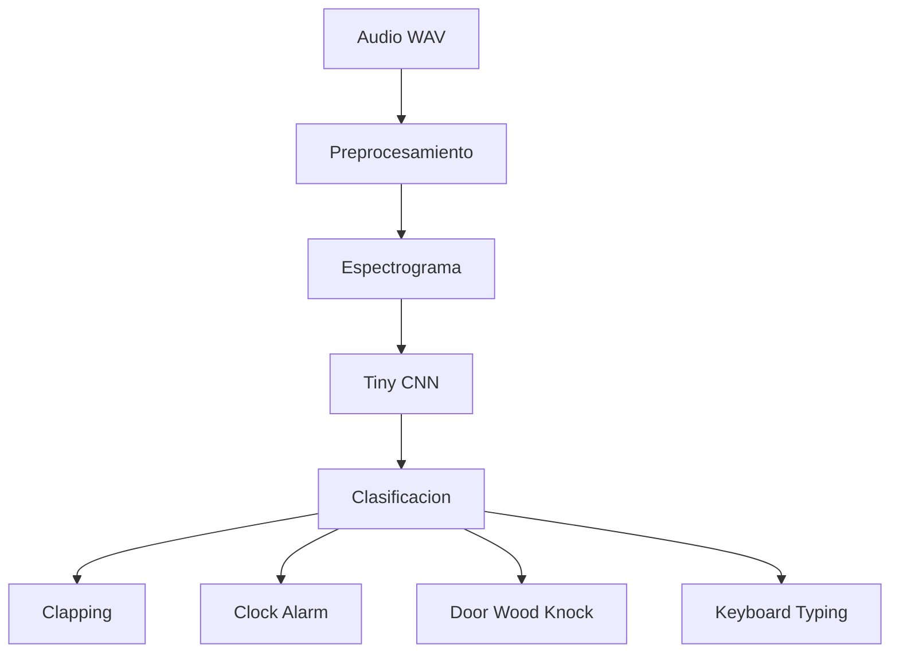
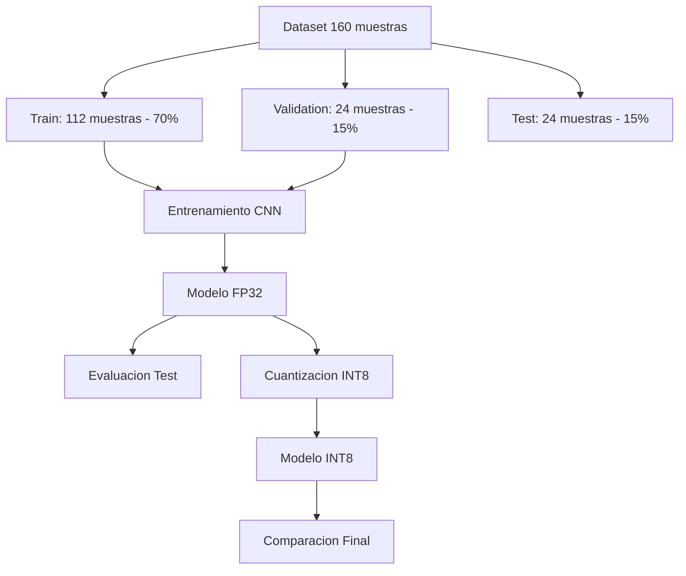

# Clasificacion de Sonidos Cotidianos mediante un Modelo TinyML Ultracompacto

## 1. Introduccion

TinyML (Tiny Machine Learning) es un area de la inteligencia artificial enfocada en ejecutar modelos de aprendizaje automatico en dispositivos embebidos con recursos de memoria, procesamiento y energia extremadamente restringidos, como microcontroladores con menos de 1 MB de memoria Flash y pocos kilobytes de memoria RAM.

En aplicaciones acusticas de borde (por ejemplo, deteccion de alarmas o monitoreo ambiental), no es viable transmitir continuamente secuencias de audio crudo hacia la nube debido a limitaciones de ancho de banda, consumo energetico y privacidad. Por ello, el procesamiento local es esencial. Sin embargo, las arquitecturas estandar de aprendizaje profundo operan en precision de punto flotante de 32 bits (FP32), demandando varios megabytes de memoria. Para hacer posible su integracion en hardware ultracompacto, es indispensable reducir el volumen del modelo aplicando tecnicas de compresion y cuantizacion entera de 8 bits (INT8).

---

## 2. Problema

El objetivo del proyecto consiste en clasificar de forma automatica y reproducible cuatro clases de sonidos cotidianos extraidos del benchmark acustico ESC-50:
1. `clapping` (aplausos)
2. `clock_alarm` (alarma de reloj)
3. `door_wood_knock` (golpes en puerta de madera)
4. `keyboard_typing` (escritura en teclado)

El flujo experimental completo debe demostrar la preparacion del dataset, exploracion, visualizacion, transformacion a espectrogramas, entrenamiento de una CNN compacta, evaluacion rigurosa en conjunto de prueba y cuantizacion INT8 con evaluacion comparativa de tamano y exactitud.



---

## 3. Dataset

Se utilizo un subconjunto cerrado del dataset estandar ESC-50 (Dataset for Environmental Sound Classification), restringido exclusivamente a las cuatro categorias del problema:

* **Directorio de origen:** `dataset/ESC-50-TinyML/`
* **Categorias:** `clapping`, `clock_alarm`, `door_wood_knock`, `keyboard_typing`.
* **Muestras por clase:** 40 archivos WAV por categoria.
* **Total de muestras:** 160 archivos WAV.
* **Duracion:** 5.0 segundos por archivo (duracion fija original de ESC-50).
* **Frecuencia de muestreo original:** 44,100 Hz.
* **Canales:** 1 (canal mono).

La estructura interna del subconjunto mantiene la nomenclatura original con distribucion homogenea en los cinco folds del benchmark original (32 muestras por fold en total, 8 por clase).

---

## 4. Exploracion de Datos

Antes de cualquier procesamiento se verificaron las propiedades fisicas y numericas de los archivos de audio:

1. **Balance de clases:** Cada una de las 4 categorias cuenta con exactamente 40 muestras (25% por categoria).
2. **Duracion uniforme:** 5.00 segundos exactos (220,500 puntos temporales a 44.1 kHz).
3. **Senal temporal:** Cada tipo de sonido exhibe una envolvente caracteristica:
   * `clapping`: impulsos breves repetitivos de alta amplitud y decaimiento rapido.
   * `clock_alarm`: ondas periodicas de tono sostenido modulado.
   * `door_wood_knock`: transitorios percusivos graves con resonancia en bajas frecuencias.
   * `keyboard_typing`: secuencias irregulares de pulsos secos de amplitud moderada.

Las figuras generadas en la carpeta `results/` son:
* `results/class_distribution.png`: Grafica de barras con la distribucion real (40 muestras por clase).
* `results/waveform_sample.png`: Forma de onda individual con ejes de Tiempo (s) y Amplitud.
* `results/waveform_comparison.png`: Comparativa simultanea de formas de onda para las cuatro clases.

---

## 5. Preprocesamiento

El pipeline de preprocesamiento convierte las senales temporales de una dimension en representaciones tiempo-frecuencia bidimensionales optimizadas para modelos convolucionales en TinyML:

```
Audio WAV (44.1 kHz, 5 s)
       ↓
Re-muestreo a 16 kHz (80,000 muestras)
       ↓
STFT (nperseg=512, noverlap=256)
       ↓
Espectrograma en escala logaritmica (dB)
       ↓
Redimensionamiento e interpolacion a matriz compacta (64 x 64)
       ↓
Normalizacion Min-Max a rango [0.0, 1.0]
       ↓
Tensor de entrada para CNN: (64, 64, 1)
```

### Parametros del Pipeline:
* **Frecuencia de muestreo objetivo:** 16,000 Hz (frecuencia estandar en reconocimiento de voz y eventos de audio de bajo consumo, capturando informacion hasta 8 kHz segun el teorema de Nyquist-Shannon).
* **Ventana STFT:** 512 muestras con solapamiento de 256 muestras.
* **Matriz final del espectrograma:** 64 x 64 x 1.
* **Normalizacion:** Escalado Min-Max individual por espectrograma para mantener invariancia ante variaciones globales de ganancia de grabacion.

### Division del Dataset:
Se aplico una particion estratificada fija (semilla aleatoria 42) sin fuga de informacion:
* **Entrenamiento (70%):** 112 muestras (28 muestras por clase).
* **Validacion (15%):** 24 muestras (6 muestras por clase).
* **Prueba (15%):** 24 muestras (6 muestras por clase).



---

## 6. Arquitectura del Modelo

Para garantizar la viabilidad en dispositivos de borde se diseno una red convolucional deliberadamente pequena, evitando arquitecturas profundas sobredimensionadas.

### Estructura de Capas:

```
Entrada: Espectrograma (64, 64, 1)
   ↓
Conv2D (16 filtros, 3x3, ReLU, padding='same') -> Salida: (64, 64, 16)
   ↓
MaxPooling2D (2x2) -> Salida: (32, 32, 16)
   ↓
Conv2D (32 filtros, 3x3, ReLU, padding='same') -> Salida: (32, 32, 32)
   ↓
MaxPooling2D (2x2) -> Salida: (16, 16, 32)
   ↓
Dropout (0.20)
   ↓
Flatten -> Vector de 8,192 caracteristicas
   ↓
Dense (32 neuronas, ReLU)
   ↓
Dense (4 neuronas, Softmax) -> Probabilidades de las 4 clases
```

### Parametros del Modelo:
* **Total de parametros:** 267,108
* **Parametros entrenables:** 267,108 (100%)
* **Parametros no entrenables:** 0

---

## 7. Entrenamiento

El entrenamiento se ejecuto con el optimizador Adam (tasa de aprendizaje inicial 0.001) y funcion de perdida `sparse_categorical_crossentropy`:
* **Tamano de lote (batch size):** 16.
* **Epocas maximas:** 40 con criterio de detencion temprana (`EarlyStopping` en `val_loss`, paciencia de 12 epocas).
* **Punto optimo restaurado:** Epoca 26.
* **Accuracy de entrenamiento en mejor epoca:** 100.0%
* **Loss de entrenamiento en mejor epoca:** 0.0128
* **Validation Accuracy en mejor epoca:** 95.83%
* **Validation Loss en mejor epoca:** 0.2869

Las curvas de convergencia estan registradas en:
* `results/training_validation_accuracy.png`
* `results/training_validation_loss.png`

---

## 8. Evaluacion en el Conjunto de Prueba

La evaluacion final se realizo exclusivamente sobre las 24 muestras del conjunto de prueba independiente (6 muestras por clase), las cuales no intervinieron en ninguna etapa de entrenamiento o ajuste de hiperparametros.

### Metricas Globales Obtenidas:
* **Exactitud (Accuracy):** 0.8333 (83.33% - 20 aciertos de 24)
* **Precision Ponderada:** 0.8705 (87.05%)
* **Recall Ponderado:** 0.8333 (83.33%)
* **F1-Score Ponderado:** 0.8366 (83.66%)

### Reporte de Clasificacion Detallado:

| Categoria | Precision | Recall | F1-Score | Soporte (Muestras) |
| :--- | :---: | :---: | :---: | :---: |
| `clapping` | 1.0000 | 0.6667 | 0.8000 | 6 |
| `clock_alarm` | 1.0000 | 0.8333 | 0.9091 | 6 |
| `door_wood_knock` | 0.8571 | 1.0000 | 0.9231 | 6 |
| `keyboard_typing` | 0.6250 | 0.8333 | 0.7143 | 6 |
| **Promedio Ponderado** | **0.8705** | **0.8333** | **0.8366** | **24** |

### Matriz de Confusion:

| Real \ Predicho | `clapping` | `clock_alarm` | `door_wood_knock` | `keyboard_typing` |
| :--- | :---: | :---: | :---: | :---: |
| **`clapping`** | **4** | 0 | 0 | 2 |
| **`clock_alarm`** | 0 | **5** | 0 | 1 |
| **`door_wood_knock`** | 0 | 0 | **6** | 0 |
| **`keyboard_typing`** | 0 | 0 | 1 | **5** |

*Figura guardada en:* `results/confusion_matrix.png`

### Analisis Acustico de Errores:
* La clase `door_wood_knock` alcanzo un recall perfecto del 100% (6/6), demostrando que la firma de baja frecuencia e impacto percusivo en madera es facilmente distinguible por los filtros convolucionales.
* La clase `clapping` experimento 2 confusiones hacia `keyboard_typing`, y `clock_alarm` registro 1 confusion hacia `keyboard_typing`. Esto se debe a que los transitorios impulsivos rapidos de las teclas mecanicas comparten caracteristicas espectrales con el chasquido inicial del aplauso y los pulsos breves de alarma.

---

## 9. Modelo Ultracompacto y Cuantizacion INT8

Para llevar el modelo entrenado a un entorno de microcontrolador se aplicaron dos fases de optimizacion:


1. **Conversion a TensorFlow Lite (FP32):** El grafo de Keras se serializa al formato eficiente FlatBuffers (`models/model_fp32.tflite`).
2. **Cuantizacion Post-Entrenamiento (INT8):** Se mapean los pesos de punto flotante de 32 bits a representaciones enteras con signo de 8 bits mediante un conjunto representativo de calibracion (`representative_dataset`), calculando la escala y el punto cero (`zero_point`) de cada tensor.

---

## 10. Comparacion FP32 vs INT8

Ambos modelos fueron evaluados con el motor de inferencia de TensorFlow Lite sobre el mismo conjunto de prueba:

| Metrica | Modelo FP32 | Modelo Cuantizado INT8 | Variacion Absoluta | Variacion Relativa |
| :--- | :---: | :---: | :---: | :---: |
| **Formato** | TensorFlow Lite FP32 | TensorFlow Lite INT8 | - | - |
| **Tamano en Disco (bytes)** | 1,072,812 bytes | 274,608 bytes | -798,204 bytes | **-74.40%** |
| **Tamano en Disco (KB)** | 1,047.67 KB | 268.17 KB | -779.50 KB | **-74.40%** |
| **Exactitud en Test (Accuracy)** | 83.33% (0.8333) | 83.33% (0.8333) | +0.00% | **0.00%** |
| **Predicciones Identicas** | Referencia | 24 de 24 (100%) | 0 discrepancias | **100% concordancia** |

### Graficas Comparativas Generadas:
* `results/model_size_comparison.png`: Comparacion de barras que evidencia la reduccion de ~1048 KB a ~268 KB (-74.4%).
* `results/model_accuracy_comparison.png`: Comparacion de barras que constata la preservacion intacta del 83.33% de precision.
* `results/results_summary.csv`: Archivo tabular reproducible con los datos exactos.

---

## 11. Conclusiones

1. **Rendimiento acustico del modelo:** A pesar de contar con un dataset reducido de solo 160 audios (40 por clase), la red convolucional ultracompacta logro un 83.33% de exactitud en el conjunto de prueba independiente y un F1-score ponderado de 0.8366.
2. **Reduccion sustancial de memoria:** La transicion de FP32 a INT8 produjo una reduccion del **74.40%** en el tamano del binario (de 1,072,812 bytes a 274,608 bytes), lo que representa una relacion de compresion cercana a 4:1, consistente con la reduccion teorica de 32 a 8 bits.
3. **Preservacion de la exactitud:** La cuantizacion INT8 no produjo degradacion alguna en el conjunto de prueba (exactitud identica de 83.33% y predicciones 100% concordantes muestra a muestra).
4. **Relevancia para TinyML:** Un modelo de 268 KB puede ser almacenado comodamente en la memoria Flash interna de microcontroladores modernos de bajo costo (como microcontroladores ARM Cortex-M4 o M7), permitiendo clasificacion acustica autonoma y de muy bajo consumo energetico sin depender de servidores remotos.
